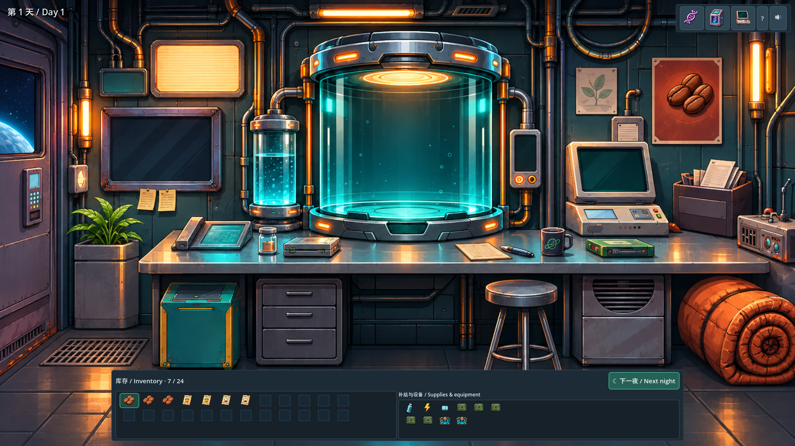
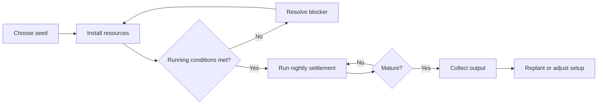
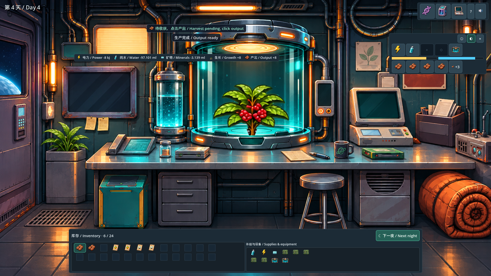
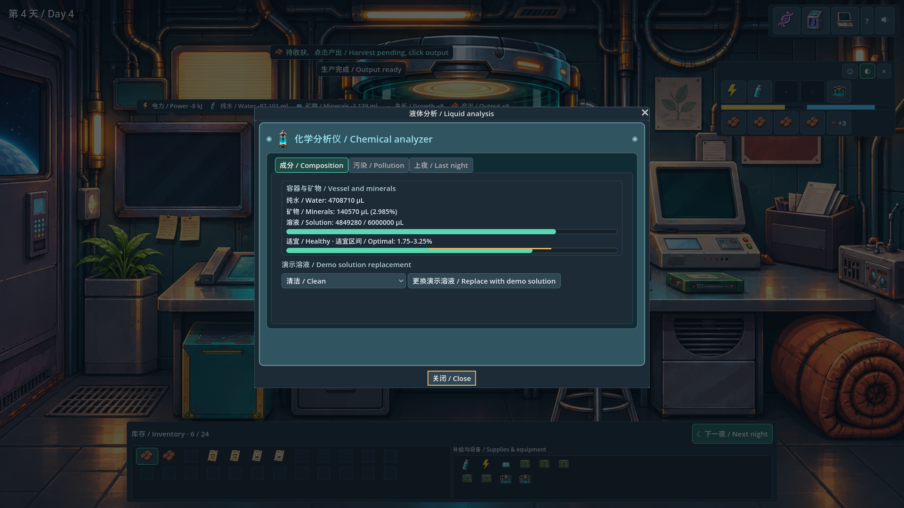

# Orbital Hydroponics | 轨道水培实验室

Orbital Hydroponics is a Godot 4 hydroponics management and cultivation simulation inspired by the agriculture system in *Probably Stolen* (深空当铺). It is an independent technical prototype, not a one-to-one recreation.

The project explores the relationship between crop growth, nutrient concentration, water use, energy, pollution, equipment, genetics and harvest quality through an orbital farming workshop. It combines gameplay design, numerical modeling, modular system architecture and experimental validation.



## Project overview

The playable workshop supports three crops: Coffee Beans, Nutrition Fruit and Kotton. Players select and plant seeds, install compatible resources and equipment, monitor machine conditions, advance nightly settlement, collect mature output and replant suitable seeds.

The active entry point is `scenes/workshop.tscn`. The legacy `scenes/main.tscn` dashboard and `scenes/coffee_dashboard.tscn` remain available as compatibility and test entry points.

## Core gameplay loop



## Implemented systems

- Three-crop cultivation with crop-specific resources and growth requirements.
- Pure water, mineral concentration, energy, pollution and inventory management.
- Machine state, equipment, compatible modules and persistent blocker feedback.
- Health, growth, harvest quantity and quality, offspring and inherited seed traits.
- DNA editing for supported traits through nightly settlement.
- Click-to-collect output, environmental disposal and capacity-aware inventory.
- Icon-based workshop navigation, hover information and drag-and-drop installation.
- Optional Farming Manual, Seed Analysis, Liquid Analysis, Equipment and DNA tools.
- Bilingual interface presentation and Reduced Motion support.
- Sixteen procedurally synthesized one-shot audio effects with volume and mute controls.

## Workshop presentation

The workshop uses a fixed 1280 × 720 and 1920 × 1080 presentation. Inventory and supply items use hover, selected and keyboard-focus states with distinct visual treatment. Drop-only slots are excluded from Tab navigation, while modal tools preserve focus and inventory selection.





## Technical architecture

The project separates static crop configuration, mutable plant and seed state, reusable liquid and calculation modules, farming settlement, and workshop presentation.

- `resources/` contains typed crop and equipment data.
- `scripts/coffee_farm.gd` coordinates farming state and nightly settlement.
- `scripts/liquid_composition.gd` owns liquid components and mineral concentration.
- `scripts/workshop_view.gd`, `workstation_view.gd` and related controls present and coordinate workshop interactions.
- `tests/` contains regression suites and deterministic numerical fixtures.

See [Technical Architecture](docs/TECHNICAL_ARCHITECTURE.md), [Calculation Contract](docs/CALCULATION_CONTRACT.md) and [Formulas](docs/FORMULAS.md).

## Numerical design

Mineral concentration uses pure water as the denominator:

\[
 C = 100 \times \frac{M}{W}
\]

Where concentration is in percent, \(M\) is mineral volume and \(W\) is pure-water volume in matching units.

A controlled Kotton experiment compared 50 mL and 150 mL of minerals in 5,000 mL of pure water, producing initial concentrations of 1% and 3%. Both runs matured after six nights and spent 48 kJ. The 1% run ended at 52% health and 12 Regular fiber; the 3% run ended at 100% health and 13 Large fiber. Both produced two offspring seeds.

## Run the project

Open `project.godot` in **Godot 4.7.2** and press F5. The workshop is the normal launch scene.

The legacy dashboard can be opened with `scenes/main.tscn`; the legacy Coffee dashboard remains under `scenes/coffee_dashboard.tscn`.

## Controls

| Input | Action |
| --- | --- |
| Double-click a machine | Open its chamber |
| Drag inventory item | Plant seed or install compatible resource |
| Drag output or discard | Collect, replant or dispose according to item type |
| Next Night | Advance one settlement |
| F1 or ? | Open the Farming Manual |
| Tab / Shift+Tab | Navigate interactive controls |
| Escape | Close the active tool or chamber |

## Testing and validation

The final candidate handover reports 20/20 automated suites passed, 1,749 explicit automated checks and four original crop assertion groups. It also reports 461 workshop GUI checks and 72 audio checks as subsets of the 1,749 total. The developer completed 29/29 standalone manual checks on each of the original and clean Windows builds. The clean build passed at both supported desktop resolutions with no issues reported.

Automated regression and developer manual acceptance are separate evidence sources. The complete suite was not rerun for documentation-only changes. Final candidate verification, Kotton results and known limitations are recorded in [Testing Report](docs/TESTING_REPORT.md).

To run the suites when an appropriate Godot executable is available:

```powershell
powershell.exe -NoProfile -ExecutionPolicy RemoteSigned -File .\tests\run-tests.ps1 -GodotPath "<Godot executable path>" -Import
```

## Documentation

- [Chinese Technical Design Analysis](docs/HYDROPONICS_DESIGN_ANALYSIS_ZH.md)
- [Game Design Document](docs/GDD.md)
- [Technical Architecture](docs/TECHNICAL_ARCHITECTURE.md)
- [Formulas and Mechanics](docs/FORMULAS.md)
- [Calculation Contract](docs/CALCULATION_CONTRACT.md)
- [Development Log](docs/DEVELOPMENT_LOG.md)
- [Testing Report](docs/TESTING_REPORT.md)
- [Demonstration Guide](docs/DEMONSTRATION_GUIDE.md)
- [Credits and Licenses](docs/CREDITS_AND_LICENSES.md)
- [Change Log](CHANGELOG.md)

## Known limitations

- The project is a focused hydroponics prototype, not a complete recreation of the reference game.
- Independent target-hardware compatibility has not been established for every export environment.
- Some reference-derived boundaries and prototype policies remain documented as unresolved research.
- The project does not have a project-wide software license.
- v1.0.0 is the intended official release for the completed technical-assessment edition.

## Development and acknowledgments

The project was developed under the developer's design direction, including gameplay research, system design, numerical analysis, interface decisions, iterative refinement and manual validation.

AI-assisted tools supported implementation, debugging, automated testing and documentation. OpenAI Codex and GitHub Copilot contributed in their respective assistant roles; ChatGPT assisted visual asset creation. The developer retained scope decisions, manual acceptance and technical direction. These contributions are described in [Credits and Licenses](docs/CREDITS_AND_LICENSES.md).

This project is not affiliated with or endorsed by the original reference-game developers or publishers.
