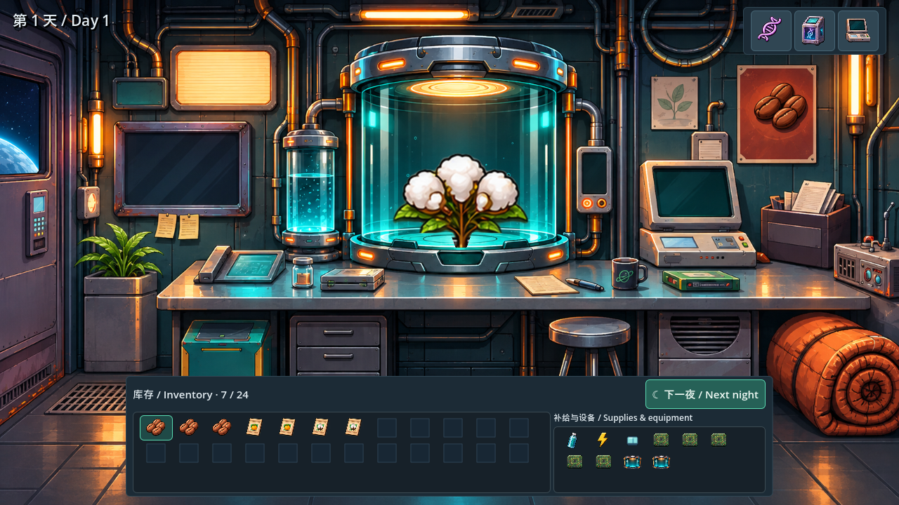

# 轨道水培实验室 | Orbital Hydroponics

**基于 Godot 4 开发的水培农业管理模拟项目**

**M11 · 精修工作间 · v0.7.0。** 支持 1280 × 720 和 1920 × 1080。使用 Godot 4.7.2 打开 `project.godot`，按 **F5** 启动。 [M11 报告](docs/M11_FINAL_REPORT.md)

[简体中文](#简体中文) | [English](#english)

---

# 简体中文

## 1. 项目简介

水培农业模拟系统是一款基于 **Godot 4** 和 **GDScript** 开发的 2D 资源管理与模拟游戏原型。

本项目以水培农业系统为核心，研究并实现作物生长、矿物质消耗、污染损伤、遗传特性以及资源管理等机制。

项目参考了游戏《深空当铺》（Probably Stolen）中的水培农业系统，并在此基础上进行独立的机制分析、系统设计与原型开发。

本项目的目标不仅是实现一个可玩的模拟系统，还包括展示游戏机制分析、数学建模、程序设计和测试验证能力。

## 2. 项目目标

- 分析参考游戏中的水培农业机制。
- 建立作物生长与资源消耗的数学模型。
- 实现水分、矿物质和电力等资源管理系统。
- 设计作物健康度与污染损伤计算机制。
- 实现不同作物及种子特性的差异化表现。
- 构建具有基本交互功能的水培管理界面。
- 通过测试验证核心计算逻辑的正确性。

## 3. 核心功能

当前演示可种植营养果、咖啡豆和韧棉。双击培养舱打开设备，拖入兼容的种子和补给。播种后自动启动，点「下一夜」推进结算，点产出图标逐件领取。底部补给托盘与计入容量的库存分开，右上角工具栏可打开液体分析、种子档案和 DNA 编辑器。

| 功能模块 | 功能说明 |
| --- | --- |
| 作物管理 | 选择、种植和收获不同作物 |
| 水资源管理 | 管理纯水储量及消耗 |
| 矿物质系统 | 计算矿物质浓度与消耗 |
| 生长系统 | 模拟作物生长进度 |
| 健康度系统 | 根据环境条件计算作物健康状态 |
| 污染系统 | 模拟污染物对作物的影响 |
| 遗传系统 | 通过种子特性影响作物表现 |
| 设备系统 | 更换设备及容器，安装已支持的模组并查看生长速度、耗电和修正值 |
| 收获系统 | 根据作物状态计算收获结果 |
| DNA 编辑 | 预览兼容性状、确认应用并通过夜间结算推进 |



[培养舱生长阶段](screenshots/m08c4-chamber-stages.png) · [素材来源](docs/ASSET_MANIFEST.md)

## 4. 初始作物范围

原型阶段计划优先实现以下三种作物：

| 作物名称 | 英文名称 | 主要研究方向 |
| --- | --- | --- |
| 营养果 | Nutrition Fruit | 基础种植与资源管理 |
| 咖啡豆 | Coffee Beans | 生长与收获机制 |
| 韧棉 | Kotton | 较长生长周期与资源消耗 |

后续将根据开发时间和系统复杂度决定是否扩展更多作物。

## 5. 技术栈

| 技术 | 用途 |
| --- | --- |
| Godot 4 | 游戏引擎 |
| GDScript | 游戏逻辑开发 |
| Git | 版本控制 |
| GitHub | 代码托管与开发记录 |
| Markdown | 项目文档 |

**开发环境：** Windows

**目标平台：** PC

**游戏类型：** 2D 模拟 / 资源管理

## 6. 项目结构

```text
hydroponics-management-simulator/
│
├── docs/                 # 项目文档
│   ├── GDD.md            # 游戏设计文档
│   ├── RESEARCH_NOTES.md # 参考游戏研究记录
│   ├── FORMULAS.md       # 核心机制与计算公式
│   ├── TECHNICAL_DESIGN.md
│   ├── DEVELOPMENT_LOG.md
│   ├── TESTING_REPORT.md
│   └── GLOSSARY.md       # 中英文术语表
│
├── scenes/               # 游戏场景
├── scripts/              # 游戏逻辑代码
├── resources/            # 作物、种子及设备数据
├── assets/               # 图片、字体及其他资源
├── tests/                # 测试代码
├── screenshots/          # 开发过程截图与演示证据
│
├── project.godot
├── README.md
└── .gitignore
```

### 运行自动化测试（Windows）

在项目根目录中运行以下命令，并将 `<Godot executable path>` 替换为 Godot 4.7.2 可执行文件的路径。第一次运行或移动测试文件后，使用 `-Import` 刷新 Godot 缓存。

```powershell
powershell.exe -NoProfile -ExecutionPolicy RemoteSigned -File .\tests\run-tests.ps1 -GodotPath "<Godot executable path>" -Import
```

## 7. 开发计划

M01–M07 建立了三作物种植循环和进阶系统。M08 扩展将默认界面改为图标式交互工作间；M09 和 M10 已验收并发布。M11 已获开发者验收，版本为 v0.7.0；M12 仍待完成。查看 [M11 报告](docs/M11_FINAL_REPORT.md)、[M10 报告](docs/M10_FINAL_REPORT.md)、[中文数值分析](docs/HYDROPONICS_DESIGN_ANALYSIS_ZH.md) 和[演示指南](docs/DEMONSTRATION_GUIDE.md)。 [项目状态](docs/PROJECT_STATUS.md) · [视觉计划](docs/VISUAL_DEVELOPMENT_PLAN.md)

## 8. 研究与参考资料

本项目的机制研究参考以下资料：

1. 《深空当铺》水培农业 Wiki  
   <https://wiki.biligame.com/probablystolen/%E6%B0%B4%E5%9F%B9%E5%86%9C%E4%B8%9A>

2. GameWith.ai — Hydroponic Farmer Guide  
   <https://gamewith.ai/probably-stolen/zh-hans/specializations/hydroponic-farmer>

参考资料用于理解和分析原游戏机制。具体实现将结合本项目的设计目标进行独立开发。

## 9. 版权与项目说明

本项目为独立开发的学习与技术展示原型。

《深空当铺》（Probably Stolen）及其相关游戏内容归原版权方所有。本项目不代表原游戏官方产品，也不声称拥有原游戏的设计或素材版权。

项目中的研究资料、原创代码、设计决策和测试记录将通过文档及 Git 版本历史进行记录。

---

# English

## 1. Project Overview

Hydroponics Management Simulator is a 2D resource management and simulation game prototype developed using **Godot 4** and **GDScript**.

The project focuses on researching and implementing hydroponic farming mechanics, including crop growth, mineral consumption, pollution damage, genetic traits, and resource management.

It is inspired by the hydroponics system in *Probably Stolen (深空当铺)*. The project independently analyzes these mechanics and develops a playable prototype based on its own system design.

The goal is not only to build a playable simulation but also to demonstrate game mechanics analysis, mathematical modeling, software engineering, and testing skills.

## 2. Project Objectives

- Analyze the hydroponics mechanics of the reference game.
- Develop mathematical models for crop growth and resource consumption.
- Implement water, mineral, and electricity management.
- Design crop health and pollution damage calculations.
- Introduce different crops and seed traits.
- Build an interactive hydroponics management interface.
- Validate core calculations through testing.

## 3. Core Features

The playable build includes three crops, state-driven artwork, a visual inventory, laboratory hotspots and specialized workstations.

| Feature | Description |
| --- | --- |
| Crop Management | Select, cultivate, and harvest different crops |
| Water Management | Manage pure water storage and consumption |
| Mineral System | Calculate mineral concentration and consumption |
| Growth System | Simulate crop growth progress |
| Health System | Calculate crop health based on environmental conditions |
| Pollution System | Simulate the effects of pollutants on crops |
| Genetics System | Apply seed traits to crop behavior |
| Equipment System | Switch machines and vessels, install supported modules and inspect speed, power and modifiers |
| Harvest System | Calculate harvest results based on crop conditions |
| DNA Editor | Preview and apply supported traits through nightly settlement |

## 4. Initial Crop Selection

The initial prototype will prioritize three crops:

| Crop | Primary Research Focus |
| --- | --- |
| Nutrition Fruit | Basic cultivation and resource management |
| Coffee Beans | Growth and harvesting mechanics |
| Kotton | Longer growth cycles and resource consumption |

The current simulation scope is frozen to these three crops. The legacy Lettuce scene remains available as a separate test fixture.

## 5. Technology Stack

| Technology | Purpose |
| --- | --- |
| Godot 4 | Game Engine |
| GDScript | Gameplay Programming |
| Git | Version Control |
| GitHub | Source Code Hosting and Development History |
| Markdown | Project Documentation |

**Development Environment:** Windows

**Target Platform:** PC

**Genre:** 2D Simulation / Resource Management

## 6. Project Structure

```text
hydroponics-management-simulator/
│
├── docs/                 # Project documentation
├── scenes/               # Game scenes
├── scripts/              # Gameplay scripts
├── resources/            # Crop, seed, and equipment data
├── assets/               # Visual and audio assets
├── tests/                # Test scripts
├── screenshots/          # Development screenshots and evidence
│
├── project.godot
├── README.md
└── .gitignore
```

### Play the three-crop farming loop

Open `project.godot` in **Godot 4.7.2** and press **F5**. The workshop supports **1280 × 720** and **1920 × 1080**. Hover over icons to inspect contents, seed traits, and slot compatibility. [Release report](docs/M08_EXTENSION_FINAL_REPORT.md) · [Workshop screenshot](screenshots/m08c4-kotton-after.png)

Double-click the chamber and drag in a Coffee Beans, Nutrition Fruit, or Kotton seed. The machine starts automatically after planting. Drag water, energy cells, tablets, or compatible modules from the supply tray to their slots. Press **Next Night** to advance. Use the liquid analyser to check the current concentration and the crop’s preferred range.

Click a ready output icon to collect one item. A full inventory leaves the rest in the chamber. Drag disposable seeds or produce onto the painted dustbin under the telephone to free space. Coffee Beans output can be replanted. For the legacy Lettuce fixture, open `scenes/main.tscn` and press **F6**.

Open the optional farming manual from the **?** button or **F1**. See the [demonstration guide](docs/DEMONSTRATION_GUIDE.md) for the complete cultivation loop, blocker recovery and optional analysis/equipment/DNA routes.

### Run the automated tests on Windows

From the repository root, replace `<Godot executable path>` with the path to the Godot 4.7.2 executable.

```powershell
powershell.exe -NoProfile -ExecutionPolicy RemoteSigned -File .\tests\run-tests.ps1 -GodotPath "<Godot executable path>" -Import
```

The runner checks all 19 suites for completion markers, exit codes and unexpected errors. Use `-Import` on the first run or after moving project files. A missing Godot cache triggers import automatically. The latest M10 evidence was executed by Codex; see [the testing report](docs/TESTING_REPORT.md#m10--2026-11-27).

Use the upper-right **DNA Editor** to preview a trait application. Drop a seed onto it to select that exact instance. Confirm the application, close the dialog and settle nights to advance it. Applications use shared power and finite demo disc charges.

Use the machine’s chassis slot to inspect equipment and vessels. Make equipment changes while the machine is stopped. A compatible installed module can be dragged back to the tray.

Use **Seed Profile** to inspect a selected seed or the planted crop. Drop a seed onto the profile icon to inspect that specific seed. Offspring and produce are offered as separate output items at maturity.

Use **Liquid Analysis** or the machine’s information icon to inspect concentration, pollutants, predicted damage, and prior-night damage. Demo solution replacement discards the current mixture and uses the separate demo supply.

## 7. Development Roadmap

M01–M07 delivered the three-crop farming loop and advanced mechanics. The M08 extension established the interactive workshop. M09 and M10 are accepted and published; M11 is developer-accepted, with all 30 manual checks passed, as v0.7.0. M12 remains. See the [M11 report](docs/M11_FINAL_REPORT.md), [M10 report](docs/M10_FINAL_REPORT.md), [Chinese design analysis](docs/HYDROPONICS_DESIGN_ANALYSIS_ZH.md), and [demonstration guide](docs/DEMONSTRATION_GUIDE.md). [Current project status](docs/PROJECT_STATUS.md) · [Visual plan](docs/VISUAL_DEVELOPMENT_PLAN.md)

## 8. Research References

The project uses the following references for mechanics research:

1. *Probably Stolen* — Hydroponics Wiki  
   <https://wiki.biligame.com/probablystolen/%E6%B0%B4%E5%9F%B9%E5%86%9C%E4%B8%9A>

2. GameWith.ai — Hydroponic Farmer Guide  
   <https://gamewith.ai/probably-stolen/zh-hans/specializations/hydroponic-farmer>

These resources are used to understand and analyze the reference game's mechanics. Implementation decisions are made independently according to this project's design goals.

## 9. Copyright and Project Disclaimer

This is an independently developed prototype for learning and technical demonstration purposes.

*Probably Stolen (深空当铺)* and its associated game content belong to their respective copyright holders. This project is not an official product and does not claim ownership of the original game's designs or assets.

Research materials, original code, design decisions, and testing records will be documented through project documentation and Git version history.

---

**Project Status:** In Development  
**Engine:** Godot 4  
**Language:** GDScript  
**Repository:** GitHub
