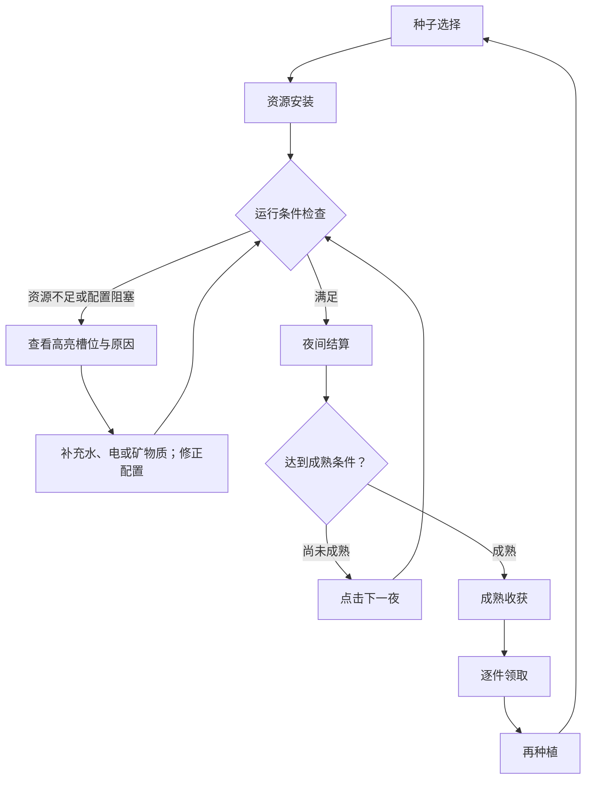
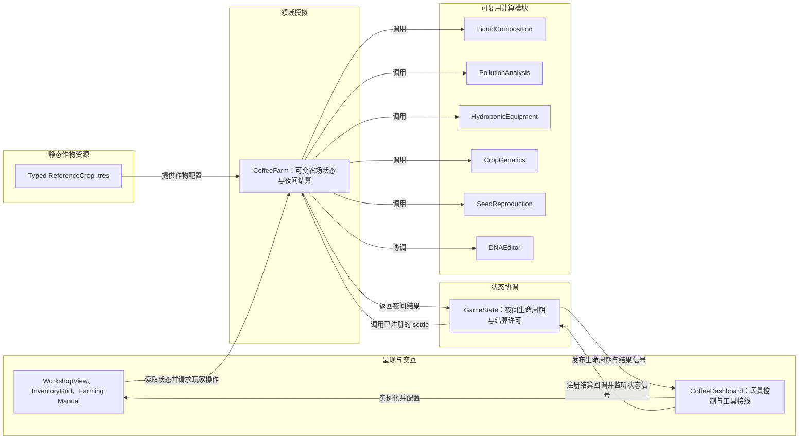

# 《轨道水培实验室：水培农业系统设计与数值分析》

> 本文面向游戏开发岗位技术评审，说明本项目的系统拆解、实际实现和一组可复现的数值对比。引用参考游戏资料用于解释设计来源，不代表本项目完整复刻《深空当铺》。

## 项目摘要

本项目响应雇主提出的水培或制药系统 Demo 任务，选择 Godot 4 实现《深空当铺》水培玩法的一个可玩的、非一比一复刻切片。核心循环覆盖选种、资源与设备管理、逐夜结算、收获和再种；模拟以类型化静态作物资源和独立可变种子/植株状态为基础，并把液体、健康、污染、设备、遗传和界面职责分开。玩家需要在有限水、矿物质和电力下安排培养条件。受控韧棉实验显示：在该测试条件下，适宜矿物浓度提高健康和收获数量/品级，但不改变成熟夜数和能耗。M10 已获开发者本地验收（19 项人工检查全部通过）；Codex 报告的自动回归也已记录，计划发布版本为 v0.6.0。

## 一、项目背景与设计目标

本项目是 Godot 4 / GDScript 水培经营模拟器，作为游戏开发岗位的技术评审作品，目标是围绕雇主要求的玩法循环拆解、系统结构、数值关系和可验证演示，把一个可理解的水培农业循环落到可玩的原型中，并展示对作物、液体、设备、污染、遗传和界面之间关系的分析能力。参考对象是《深空当铺》的水培农业系统；本项目只实现了明确选择的核心规则和演示范围，不是参考游戏的完整重制。

研究观察与本地实现需要分开理解：资料页用于建立机制假设和数值基线；`FORMULAS.md`、`CALCULATION_CONTRACT.md` 与各里程碑报告记录已核对规则、项目策略、暂定边界和仍未解决的差异。以下描述以当前仓库实现为准，不把未实现或未验证的参考机制写成项目功能。

原始雇主要求给出十天时限，但没有提供明确的起始时间和截止时间；项目文档记录了 2026-12-01 的交付目标。现有材料不足以独立核实是否严格在十天内完成，因此本文不宣称时间要求已经核验。

### 开发过程与个人贡献

下表依据项目记录说明分工，不把 AI 辅助产出描述为个人手工实现，也不超出已有证据推定个人作者身份。

| 工作内容 | 有记录的贡献与证据 |
| --- | --- |
| 参考游戏研究与数值分析 | 项目保存原始参考页面、研究笔记、公式表和计算契约，并标注来源、项目策略与未决边界。本文沿用这些项目级证据；没有把每条研究记录都归为某一人的独立原创。 |
| 项目范围与里程碑 | 开发者选择水培与 Godot，并在项目记录中确认阶段范围、演示方向和后续里程碑。项目明确不做完整复刻。 |
| 玩法与视觉方向 | 开发者批准以轨道工作间为正常入口、图标交互、自动运行、逐夜推进和逐件领取等方向；这些决定见现行项目状态和视觉开发记录。 |
| 交互需求与问题反馈 | 开发者报告电池耗尽后的首次拖拽问题，并提出状态可读性与引导需求。Codex 复现并实现交互修正；本节按交接与测试记录描述，不把它写成模拟公式变更。 |
| 测试与技术验收 | 开发者于 2026-11-27 完成并通过 19 项 M10 人工验收。Codex 执行自动回归；开发者依据结果作本地验收决定。 |
| AI 辅助开发与文档 | Codex 负责本次 M10 工作间实现和自动化验证；Copilot 负责本次中文分析、里程碑报告、演示指南及相关文档更新。开发者保留设计决定和人工验收权。 |

## 二、核心玩法循环

玩家从库存选择作物种子，将其拖入培养舱；在机器运行前检查水、矿物质浓度、电力和可选模块。满足条件后，机器自动运行。玩家点击“下一夜（Next Night）”推进结算：模拟器先验证整夜所需资源，再统一提交资源扣除、作物生长和健康变化。机器受阻时，槽位高亮并说明缺少的资源或配置。

成熟后，产出逐件显示和领取；库存已满时，未领取产出仍留在机器中。咖啡豆产物可再次播种；营养果和韧棉的可售产物不是种子，繁殖种子作为独立产出呈现。玩家收集并重新播种，完成下一轮。现行工作间还支持把废弃种子或产品拖入垃圾桶释放库存空间。可选种植手册提供快速入门和进阶工具入口。完整演示步骤见[演示指南](DEMONSTRATION_GUIDE.md)。



设计解读：资源不足不是独立惩罚，而是循环中的一个可恢复状态。玩家可以在继续推进前识别阻塞项并调整补给或配置；有限库存和逐夜成本因此形成计划压力，而不是隐藏的随机失败。

## 三、水培系统架构

正常游戏入口是[`scenes/workshop.tscn`](../scenes/workshop.tscn)，它实例化启用工作间的[`scenes/coffee_dashboard.tscn`](../scenes/coffee_dashboard.tscn)。`coffee_dashboard.gd`连接农场、`GameState`和分析/设备/基因工具；[`scripts/workshop_view.gd`](../scripts/workshop_view.gd)构建轨道工作间的机器、库存和交互呈现。[`scripts/inventory_grid.gd`](../scripts/inventory_grid.gd)负责图标网格及拖放资格，[`scripts/workshop_manual.gd`](../scripts/workshop_manual.gd)负责可选手册。旧仪表盘逻辑和[`scenes/main.tscn`](../scenes/main.tscn)中的 Lettuce 兼容入口仍保留，但不是默认游玩入口。

模拟与呈现分层：

| 层 | 当前职责 | 代表文件 |
| --- | --- | --- |
| 静态作物配置 | 以类型化资源保存作物阈值、生长、产量、耗液和原生性状；作为共享配置读取 | [`resources/coffee_beans.tres`](../resources/coffee_beans.tres)、[`resources/nutrition_fruit.tres`](../resources/nutrition_fruit.tres)、[`resources/kotton.tres`](../resources/kotton.tres) |
| 可变领域状态 | 持有液体、能量、库存、种子实例、植株、设备和生产状态 | [`scripts/coffee_farm.gd`](../scripts/coffee_farm.gd) |
| 可复用计算 | 分别处理液体账本、污染、设备、遗传、繁殖和 DNA 编辑 | [`scripts/liquid_composition.gd`](../scripts/liquid_composition.gd)、[`scripts/pollution_analysis.gd`](../scripts/pollution_analysis.gd)、[`scripts/hydroponic_equipment.gd`](../scripts/hydroponic_equipment.gd)、[`scripts/crop_genetics.gd`](../scripts/crop_genetics.gd)、[`scripts/seed_reproduction.gd`](../scripts/seed_reproduction.gd)、[`scripts/dna_editor.gd`](../scripts/dna_editor.gd) |
| 状态协调 | 管理夜间状态、结算许可和完成通知 | [`scripts/game_state.gd`](../scripts/game_state.gd) |
| 呈现和交互 | 展示工作间、提示、分析工具和玩家操作，不负责定义作物公式 | [`scripts/workshop_view.gd`](../scripts/workshop_view.gd)、[`scripts/coffee_dashboard.gd`](../scripts/coffee_dashboard.gd) |



农场先在分离的液体快照上验证并暂存整夜消耗；整笔操作可提交后才更新农场状态并发布完成信号，避免资源只扣一部分。静态作物资源与可变种子/植株实例分开，使同一作物定义可供不同种子和遗传状态复用。架构边界与计算约定详见[技术设计](TECHNICAL_DESIGN.md)、[计算契约](CALCULATION_CONTRACT.md)和[公式记录](FORMULAS.md)。

## 四、资源管理与策略设计

水培槽把纯水、矿物质和其他液体成分作为独立体积保存，单位为整数微升；界面以毫升显示，`1 mL = 1,000 µL`。一夜的混合液抽取按槽内各成分比例分摊，营养片补入矿物质时需考虑槽容量和置换。纯水补给会稀释浓度。能量以项目界面使用的 kJ 单独记账，不与液体混算。

标准机器每夜提供 8 点生长并消耗 8 kJ；旧设备和破旧设备有各自固定的演示参数。设备需要同时满足整夜耗液和电力条件，阻塞时夜间不会产生半笔资源交易。玩家可以在停机时装卸模组，权衡生长速度、电力效率和作物专属产出。储备、补给和库存容量均有限，因此浓度选择、加水、添加营养片和模块选择都可能影响后续夜晚是否能继续运行。

设计解读：有限补给要求玩家关注未来数夜而不是只优化当前一夜。补水会稀释矿物浓度，营养片会增加矿物质但占用槽位容量，能量和混合液不足又会阻止夜间结算；因此“储备多少、何时补、是否装模组”是相互关联的规划选择。这里说明的是玩法决策结构，不额外主张某种策略在所有作物下都最优。

## 五、矿物质浓度与作物生长

当前浓度按纯水体积作分母：

`C_m (%) = 100 × M / W`，其中 `M` 为矿物质体积、`W` 为纯水体积，二者使用相同单位且 `W > 0`。

机器以作物定义中的低、高浓度边界分类。低于范围时，每个实际生长点造成 100 点健康损失；范围内不产生该项损失；高于范围时每点损失 50 点。健康内部值为 0–10,000，展示百分比为内部值除以 100。矿物判定使用夜间消耗前的状态；夜间先验证并计算矿物吸收与混合液抽取，再提交结果。

韧棉资源定义的适宜范围是 2%–5%，每晚混合液抽取 250 mL、每生长点吸收 75 µL。健康还会影响韧棉最终数量与大小分布。因此矿物补给不是单纯增加库存：它改变植物健康，进而影响成熟产量和品级。实际阈值及边界以[`scripts/coffee_farm.gd`](../scripts/coffee_farm.gd)、[`scripts/liquid_composition.gd`](../scripts/liquid_composition.gd)和[`resources/kotton.tres`](../resources/kotton.tres)为准；一般公式见[`FORMULAS.md`](FORMULAS.md)的 F-MIN 与 F-HLT 条目及[`CALCULATION_CONTRACT.md`](CALCULATION_CONTRACT.md)。

设计解读与测量需分开：低于范围会按生长点扣健康，而健康档位再影响最终数量和品级；因此营养浓度可能改变“收成质量”，不只是剩余资源读数。第九节的两组数字是一个受控实例的实测结果，不构成其他作物或配方的普遍预测。

## 六、水质与污染机制

污染模块分别处理六类有害成分：重金属、化学物、微生物、有机废物、酸和碱。每种成分先计算以纯水为基准的污染指数，再乘作物敏感度后查表，乘作物损伤因子和本夜实际生长点数，最后合并损伤。实现形式为：

`I_i = 10,000 × V_i / W`；`E_i = I_i × s`；`D_p = g × Σ(lookup(E_i) × f)`

其中 `V_i` 是该有害成分体积，`s` 为作物敏感度，`g` 为本夜生长点，`f` 为作物污染损伤因子。韧棉数据中的原生敏感度为 1.50454、损伤因子为 1.26。物理污染和惰性成分会占槽体积并随液体抽取，但不进入这六类直接伤害求和。

参考资料给出了整数档位，但没有解决所有小数暴露值的归档和最终舍入。本项目当前使用文档化的暂定工程规则：按列出的闭区间上限归档，对各成分累计后按最近整数、半数进位处理，再与矿物损伤合并并限制在可扣除健康值内。此策略是当前实现的可复现约定，不应被描述为已证实的参考游戏内部规则。见[`scripts/pollution_analysis.gd`](../scripts/pollution_analysis.gd)、[`FORMULAS.md`](FORMULAS.md)和[`CALCULATION_CONTRACT.md`](CALCULATION_CONTRACT.md)的 F-POL 与 F-OPEN-04。

## 七、设备模块与效率设计

当前演示提供标准、旧设备和破旧设备；后两者的配置锁定。标准设备有三个可配置演示槽位。以下 P/E 是项目设备计算中的性能/效率百分比点，所有受支持模块的质量调整为中性：

| 模块 | 性能 / 效率变化 | 实际效果 |
| --- | ---: | --- |
| 营养果模组 | −10 / −10 | 每安装一个模组，营养果增加 1 个 |
| 自动织造 | −50 / −100 | 韧棉纤维按相同数量替换为织物 |
| 性能模组 | +16 / 0 | 调整设备生长速度 |
| 效率模组 | 0 / +16 | 调整每夜能耗 |
| 环保模组 | −16 / +32 | 以性能换取更高能效 |

性能与效率先汇总再进入机器计算；模组不会改变当前支持作物的固定混合液抽取或繁殖规则。随机形状/词条、扩展模块网格、完整电力网络以及正负品质如何映射到产量仍不属于已完成范围。设备定义与解析见[`scripts/hydroponic_equipment.gd`](../scripts/hydroponic_equipment.gd)和[M07 设备报告](M07_PACKAGE_A_REPORT.md)。

设计解读：性能模组提高每夜生长点数，可能缩短达到成熟所需的夜数；效率模组降低每个运行夜的能耗，但本身不增加生长点数。性能变化也会改变每夜按生长点计算的矿物吸收，而固定混合液抽取和能耗分别受现有规则约束。因此应按当前瓶颈选择，而不能把“速度更快”直接等同于“所有资源都更省”。

## 八、种子属性与遗传系统

作物资源保存原生性状和生长/产出参数；每颗种子保存独立的可变性状等级与编辑热量。种植时解析种子性状并建立植株状态，避免修改一颗种子时改变共享作物定义。已实现的主要可计算性状包括生长速度、产量、混合液抽取和污染敏感度；部分元数据性状用于繁殖或咖啡成分查看。

繁殖按作物配置的尝试次数、成熟健康和 Fertile/Sterile 性状计算。韧棉的繁殖次数随健康区间变化，并可能增加一次随机尝试；子代继承亲本当前性状，热量重置。固定随机种子只用于可复现测试，不表示游戏中的繁殖始终固定。

DNA 编辑器实现的是兼容性检查和单项性状应用：操作消耗演示数据盘与电力，按夜推进，成功增加性状并消耗一次数据盘使用；失败保留性状和数据盘，但成功或失败都会增加热量。当前没有实现参考系统的完整提取/冷却/取消等操作。韧棉原始耗液量尚未解析，因此改动其耗液性状会被拒绝。性状计算和限制见[`scripts/crop_genetics.gd`](../scripts/crop_genetics.gd)、[`scripts/seed_reproduction.gd`](../scripts/seed_reproduction.gd)、[`scripts/dna_editor.gd`](../scripts/dna_editor.gd)和[M07-B 报告](M07_PACKAGE_B_REPORT.md)。

设计解读：在已实现范围内，种子性状会影响后续种植，韧棉子代继承亲本性状，这为跨轮次的选种和性状规划提供了基础。它还不是完整的遗传育种系统：编辑操作有限，部分性状仍受来源和数据缺口约束，随机繁殖结果也不能被当成固定保证。

## 九、数值对比实验

M10 的确定性测试使用原生韧棉、5,000 mL 纯水、100 kJ、标准机器、无模组、无额外污染及 RNG seed 42。仅改变初始矿物质体积。测试实例化正常工作间场景，执行完整六夜循环并输出状态；以下为 Codex 交接中报告的测量值，不是本次 Copilot 重新执行的结果。

| 指标 | 低于适宜范围 | 适宜范围 |
| --- | ---: | ---: |
| 初始矿物质 / 初始浓度 | 50 mL / 1.000% | 150 mL / 3.000% |
| 最终浓度 | 0.917% | 2.917% |
| 成熟夜数 / 最终生长 | 6 / 48 | 6 / 48 |
| 混合液抽取 | 1,500 mL | 1,500 mL |
| 纯水消耗 | 1,485.826 mL | 1,456.961 mL |
| 矿物质总损失 | 17.774 mL | 46.639 mL |
| 能量消耗 | 48 kJ | 48 kJ |
| 最终健康 | 52% | 100% |
| 收获 | 12 份普通纤维 | 13 份大型纤维 |
| 子代 | 2 粒种子 | 2 粒种子 |

表中矿物质总损失包含植株吸收和混合液抽取带走的矿物质；测试断言两组植株吸收量均为 3.6 mL。

在这一组受控条件下，适宜浓度使健康提高 48 个百分点；数量从 12 增至 13，相对低浓度结果增加约 `(13−12)/12 = 8.33%`；品级由普通变为大型。两组都需六夜、抽取同量混合液、消耗 48 kJ。适宜组矿物质总损失较高，纯水消耗较低；这说明玩家以矿物投入换取健康和收获结果，而不是免费获得提升。它只证明这一原生韧棉设置中的结果，不能外推到其他作物、模块、污染或浓度组合。

### 逐步计算

本例把 `M` 和 `W` 都用 mL 表示；模拟内部对应 `50,000 µL` 和 `5,000,000 µL`，单位一致。健康内部值以 10,000 表示 100%，显示百分比为内部值除以 100。

1. **初始矿物浓度（低于韧棉 2% 下限）：** `50 mL / 5,000 mL × 100 = 1%`。
2. **累计生长：** 标准机器每夜提供 8 点，测试运行六夜：`6 × 8 = 48` 点。作物目标为 43 点，但结算保留最后一夜完整的 8 点增量，因此结果是 48，而不是截断到 43。
3. **矿物吸收：** 每点吸收 75 µL：`48 × 75 µL = 3,600 µL = 3.6 mL`。两组测试都断言该吸收量相同；表中的总矿物损失还包括混合液抽取带走的部分。
4. **低浓度健康：** 六夜浓度均低于下限时，每生长点损失 100 个内部健康单位：`(10,000 − 48 × 100) / 100 = 52%`。这与测试记录的最终健康 5,200/10,000 一致。
5. **收获数量差：**`(13−12)/12 × 100% ≈ 8.33%`。这是相对于低浓度组 12 份纤维的增加比例；本次健康与韧棉的产量档位共同产生 12 与 13 的结果，不能推广到其他配置。

这些计算对应[`CALCULATION_CONTRACT.md`](CALCULATION_CONTRACT.md)中的 F-MIN-01、F-MIN-02、F-HLT-02、F-GRW-03 和 F-HRV-02，并与[`scripts/coffee_farm.gd`](../scripts/coffee_farm.gd)和[`resources/kotton.tres`](../resources/kotton.tres)的实现参数一致。测试脚本输出初末浓度等测量值，并明确断言六夜生长序列、健康、收获数量、能耗、混合液抽取和矿物吸收；其细粒度浓度、纯水消耗和矿物总损失来自该夹具输出及 Codex 交接记录，而非每项都被写成硬编码的期望值。

测试脚本为[`tests/test_m10_nutrient_demo.gd`](../tests/test_m10_nutrient_demo.gd)，场景为[`tests/test_m10_nutrient_demo.tscn`](../tests/test_m10_nutrient_demo.tscn)。从项目根目录执行：

```text
Godot --headless --debug --path . res://tests/test_m10_nutrient_demo.tscn
```

## 十、交互设计与玩家体验

项目从旧仪表盘式布局转为沉浸式轨道工作间，采用图标库存和培养舱、悬停提示、拖放安装、机器自动运行、逐夜推进和点击领取。状态反馈尽量沿用同一结算结果：阻塞槽位说明原因，夜间反馈显示真实资源/生长变化；提示层不拦截鼠标输入。暗色半透明状态底板提升文字可读性。

种植手册是可选入口，包含 Quick Start / Advanced 两个标签页，通过 `?` 按钮或 F1 打开。高级入口连接已有液体分析、设备和 DNA 编辑工具；关闭手册或跳转工具时保留库存选择。减少动态效果设置继续控制动画呈现，不改变模拟结果。对应实现和测试见[`scripts/workshop_view.gd`](../scripts/workshop_view.gd)、[`scripts/workshop_manual.gd`](../scripts/workshop_manual.gd)和[`tests/test_workshop_ui.gd`](../tests/test_workshop_ui.gd)。

设计解读：持久阻塞提示回答“为什么不能继续”，临时反馈只强调刚发生的变化；指针穿透避免提示层截获拖放，手册和工具导航保留库存选择则减少重复定位。Reduced Motion 改变反馈动画而不改结算值，让玩家可以降低动态效果而不失去结果信息。

## 十一、测试验证与问题修复

Codex 的 M10 交接报告记录：19 个回归套件通过、1,440 项显式自动检查（其中包括 224 项工作间 GUI 检查）、另有四组原始作物断言；默认启动和旧 Lettuce 基线通过；两个支持分辨率的渲染截图均经检查。GUI 检查覆盖状态可读性、持久阻塞与临时反馈、指针穿透、F1/手册导航、库存选择保留、耗尽后立即拖入一份电池、水/种子/模块拖放，以及 Coffee 收获和再种。上述自动结果由 Codex 执行，不是 Copilot 对本次任务的独立复测。

开发者于 2026-11-27 单独报告 **19/19 项人工验收全部通过**：电池耗尽与告警、首次立即拖入且恰好补充一份、恢复后告警清除（5 项）；状态可读性、底板布局、拖放不受阻及临时反馈过期（4 项）；手册 `?`/F1、两个标签页、分析工具入口和库存选择保留（5 项）；完整 Coffee 种植循环、领取与再种、Reduced Motion、1280 × 720 和 1920 × 1080 布局（5 项）。这是开发者桌面验收，与 Codex 自动化结果分开记录。依据是本次提供的正式验收记录；Codex 交接末尾较早的“桌面验收待定”句子已由该记录取代。M10 已获开发者本地验收，GitHub 发布仍待后续授权。

电池问题说明了为何要把模拟状态与界面资格分开：结算完成回调发生时，`GameState` 的锁尚未释放；网格刷新把锁定时的资格缓存下来，造成第一次拖放被拒绝。运行时重新调用 `farm.can_act()`，让拖拽起始和放置判定都使用当前状态。第一个电池拖放立即成功且只转入一份补给，其他三类拖放也通过回归。该修复不改变能量扣除、机器成本或作物计算。更多证据见[M10 报告](M10_FINAL_REPORT.md)与[测试报告](TESTING_REPORT.md#m10--2026-11-27)。

## 十二、项目限制与后续优化

- 本作是针对水培农业主题的技术评审原型，不是《深空当铺》的完整重制；现有内容聚焦三种作物、可控演示资源和有限设备/遗传操作。
- 污染小数档位、部分舍入和品质映射仍是有记录的项目策略或未解决研究；韧棉原始耗液性状未确定，相关编辑被限制。测试中的数值不能取代对这些边界的说明。
- M10 已获开发者验收，计划版本为 v0.6.0。M11 仍计划统一悬停、键盘焦点、禁用状态、字体和间距，并在明确硬件上测量交互表现；只有获得批准的音频资产及静音处理后才考虑音效。
- M12 仍需执行最终全回归、干净副本启动、目标平台/交付格式确认、截图或导出（如获同意）、署名和提交材料核对。没有实测数据前不报告性能结论。

### 雇主要求覆盖情况

| 原始要求 | 本文覆盖与证据 | 结论 / 尚未核实 |
| --- | --- | --- |
| 制作水培或化学制药 Demo | 选择水培；第二节和演示指南说明可玩的种植、结算、收获循环 | 已覆盖水培方向 |
| 独立拆分玩法设计和数值设计；不要求一比一复刻 | 第二至第九节拆解流程、领域与资源规则，并展示带来源的数值实验 | 已覆盖；本文明确不是完整复刻 |
| 使用 Unity 或 Godot；时限十天 | 项目使用 Godot 4.7.2 | 引擎要求已覆盖；由于原始 brief 未给精确起止时间，是否严格满足十天无法核实 |
| 尽可能贴近《深空当铺》并分析其设计和数值 | 以引用页面和计算契约说明实现；第十二节披露未实现和未决范围 | 有限覆盖并透明说明；不宣称完整机制保真 |
| 接近入职后的独立游戏开发工作 | 记录从抽象要求到玩法循环、系统边界、验证与交付限制的拆解过程 | 提供过程证据；雇主评估结果未知 |
| 不仅编写代码，还要展现玩法理解和抽象需求落地能力 | 通过资源决策解释、可玩流程、确定性比较、自动验证与开发者人工验收展示 | 本文展示的是项目证据；不把 AI 实现冒称为个人手写代码 |

原始要求见[雇主要求记录](EMPLOYER_REQUIREMENTS.md)。该文件保留的 “M08 remains unauthorized” 是较早阶段文字；当前项目状态为 M10 已本地获开发者验收、发布待定，本文不沿用该历史状态。

## 参考与实现依据

- [水培农业 Wiki（原始项目参考页）](https://wiki.biligame.com/probablystolen/%E6%B0%B4%E5%9F%B9%E5%86%9C%E4%B8%9A)；[M02 锁定修订版](https://wiki.biligame.com/probablystolen/index.php?title=%E6%B0%B4%E5%9F%B9%E5%86%9C%E4%B8%9A&oldid=11463)。
- [GameWith 水培农夫指南](https://gamewith.ai/probably-stolen/zh-hans/specializations/hydroponic-farmer)。
- [水培系统](https://wiki.biligame.com/probablystolen/index.php?title=%E6%B0%B4%E5%9F%B9%E7%B3%BB%E7%BB%9F&oldid=11302)、[植物基因](https://wiki.biligame.com/probablystolen/%E6%A4%8D%E7%89%A9%E5%9F%BA%E5%9B%A0)、[DNA 编辑器修订版](https://wiki.biligame.com/probablystolen/index.php?title=DNA%E7%BC%96%E8%BE%91%E5%99%A8&oldid=11303)。
- 作物资料：[营养果](https://wiki.biligame.com/probablystolen/index.php?title=%E8%90%A5%E5%85%BB%E6%9E%9C&oldid=10458)、[咖啡豆](https://wiki.biligame.com/probablystolen/index.php?title=%E5%92%96%E5%95%A1%E8%B1%86&oldid=10718)、[韧棉种子](https://wiki.biligame.com/probablystolen/index.php?title=%E9%9F%A7%E6%A3%89%E7%A7%8D%E5%AD%90&oldid=10809)；[植物分析仪](https://wiki.biligame.com/probablystolen/%E6%A4%8D%E7%89%A9%E5%88%86%E6%9E%90%E4%BB%AA)与[水质扫描仪](https://wiki.biligame.com/probablystolen/%E6%B0%B4%E8%B4%A8%E6%89%AB%E6%8F%8F%E4%BB%AA)。
- [机器模组](https://wiki.biligame.com/probablystolen/%E6%9C%BA%E5%99%A8%E6%A8%A1%E7%BB%84)、[水培专用模组](https://wiki.biligame.com/probablystolen/%E6%B0%B4%E5%9F%B9%E5%86%9C%E4%B8%9A#水培专用模组)及[韧棉织造](https://wiki.biligame.com/probablystolen/%E9%9F%A7%E6%A3%89%E7%A7%8D%E5%AD%90#模组)。
- 本地依据：[雇主要求](EMPLOYER_REQUIREMENTS.md)、[GDD](GDD.md)、[公式](FORMULAS.md)、[计算契约](CALCULATION_CONTRACT.md)、[研究笔记](RESEARCH_NOTES.md)、[M07 设备报告](M07_PACKAGE_A_REPORT.md)、[M07-B DNA 报告](M07_PACKAGE_B_REPORT.md)、[M10 测试报告](TESTING_REPORT.md#m10--2026-11-27)。
