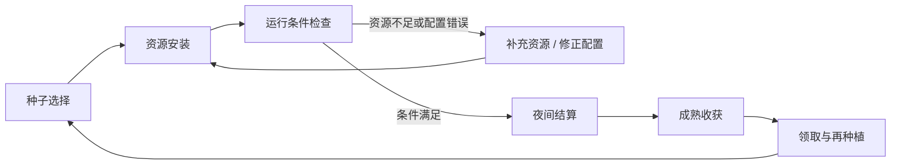
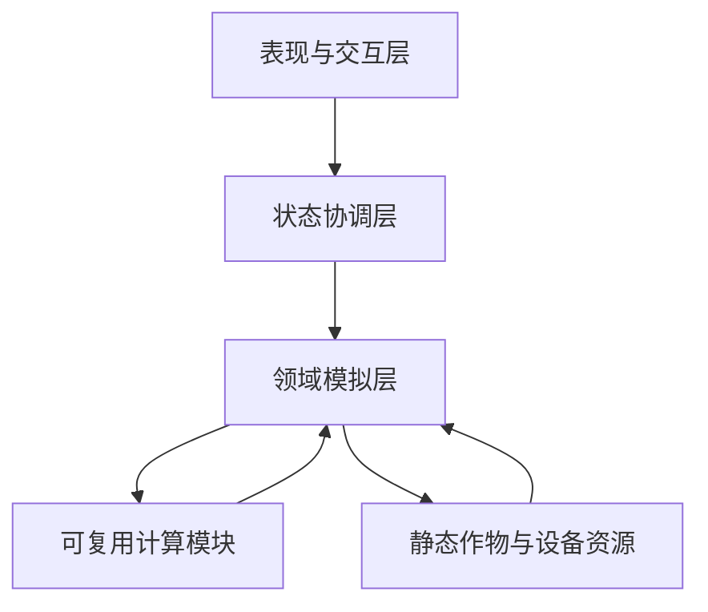

# 《轨道水培实验室：水培农业系统设计与数值分析》

本文面向游戏开发岗位技术评审，说明《轨道水培实验室》的玩法理解、系统结构、数值关系、交互设计、验证证据和项目局限。参考资料用于说明机制来源，不代表对《深空当铺》的完整复刻。

## 项目摘要

本项目使用 Godot 4 和 GDScript 实现了以轨道工作间为中心的可玩水培管理切片。核心循环包括选择种子、安装资源、确认运行条件、逐夜结算、成熟收获和再种。三种作物共享统一的液体、健康、污染、设备、遗传和库存框架，但保留独立作物参数。

玩家需要在有限水、矿物质、营养片和电力之间作出选择。设备与模组改变运行表现，矿物浓度影响作物健康和收获品级，污染降低健康，种子性状和继承机制为连续培养提供策略。受控韧棉实验显示，在相同成熟夜数和能耗下，适宜矿物浓度可提高健康和收获品级。

## 一、项目背景与设计目标

项目源于雇主提出的“水培或化学制药 Demo”任务。目标不是完整复刻，而是拆分并实现一组能够说明设计理解、数值建模、抽象需求落地、交互反馈和验证能力的机制。项目选择水培方向，并以 Godot 4 建立可运行的三作物原型。

本项目实现的范围是：

- 营养果、咖啡豆和韧棉三种作物。
- 纯水、矿物质、营养片、电力和污染资源。
- 设备、容器和兼容模组。
- 作物健康、遗传、种子繁殖和收获。
- 图标式工作间、拖放安装、逐件收获和工具窗口。
- 双语文字、键盘导航、Reduced Motion 和音频设置。

未纳入范围的完整参考机制、部分参考数值和原始液体特性仍在项目限制中明确标注。

## 二、核心玩法循环

玩家首先选择种子并将它放入培养槽。下一步是补充纯水、矿物质和电力，并根据机器状态安装兼容设备或模组。夜间结算只在运行条件满足时推进；受阻时界面指出具体槽位或缺失资源。

成长期结束后，产出逐件进入容量受限的库存。咖啡豆产物可再种植，营养果和韧棉产物可作为独立种子或产出处理。环境处置入口用于处理不需要保留的种子或物品。

设计解读：资源稀缺不是单纯的失败提示，而是让玩家比较补给、设备和作物选择的成本。持久阻塞反馈减少重复尝试，临时反馈说明结算变化，拖放恢复由实时状态决定，不依赖错误的缓存。

## 三、系统架构

表现层包括工作间、库存、培养槽、工具窗口和手册。状态协调层处理选种、夜间推进、资源交易和结果发布。领域模拟层包括液体、作物、健康、污染、遗传、繁殖和设备；可复用计算模块提供浓度、吸收、健康、增长和收获规则。

静态作物参数保存在类型化资源中，可变植株和种子实例独立保存成长、健康和遗传状态。具体职责见 [技术架构](TECHNICAL_ARCHITECTURE.md)、`scripts/coffee_farm.gd` 和 `scripts/liquid_composition.gd`。

## 四、资源管理与交易

纯水、矿物质和电力构成主要运行约束。补充、安装和夜间消耗必须经过完整校验，资源只在操作提交后变化。单次操作失败不会留下部分余额变更。

矿物浓度按纯水体积计算：

\[
C = 100 \times \frac{M}{W}
\]

分母是纯水量，不是包含矿物质后的混合液量。单位必须匹配；项目液体模块使用微升，浓度以百分比表示。

设计解读：玩家需平衡补充成本与生长收益。适宜矿物浓度可以提高健康和品级，但矿物不足、过量或整体资源不足都会改变决策成本。

## 五、作物生长与健康

作物的成熟夜数、基础生长、耗水、矿物吸收、适宜浓度和收获参数来自数据资源。静态配置与实际植株状态分离，使同一作物的多粒种子可以具有不同性状和成长表现。

隐藏健康值以 10,000 为初始尺度。公开百分比健康是隐藏值除以 100 的结果。例如：

\[
S=\frac{H}{100}
\]

矿物浓度适宜时不产生该项低浓度健康损失；低于或高于最佳区间时会按夜扣除健康。污染和其他环境因素使用独立规则叠加影响生长评分。

设计解读：健康是资源管理和污染管理的综合结果，而不是随机数。玩家可通过液体分析检查浓度、预测风险和查看上一夜损伤。

## 六、污染与环境风险

污染物与液体组成一起保存。夜间结算会按作物污染敏感度和当前环境计算损伤，并与健康状态关联。污染小数档位、舍入策略和部分参考边界属于已记录的原型策略。

玩家可以观察污染原因、资源变化和健康变化。环境处置与演示液体替换提供受控恢复方式，但不会绕过原有资源校验或建立未实现机制。

设计解读：污染为资源补充增加条件成本。只追求短期生长可能提高即时产量，却增加健康损失或降低收获质量。

## 七、设备、模组与能源效率

机器、容器和模块提供生长、耗能、容量或修正效果。设备选择应结合作物周期、矿物需求和当前电力储备，而不是追求单项最大数值。

运行中的机器不会接受会破坏运行状态的设备操作。界面解释不可用原因，并保留可用操作的清晰入口。

设计解读：设备性能和能量效率形成取舍。高性能配置可以缩短或改善操作，但会提高能源成本；保守配置有利于资源控制，但可能延长生产周期。

## 八、遗传与种子繁殖

种子记录可变实例性状，静态作物资源则保存基础参数。繁殖、继承和品质计算使用独立模块，并按作物成熟健康和配置尝试次数确定结果。

DNA 编辑器只实现兼容性检查和有限性状应用。操作消耗演示数据盘和电力，并通过夜间结算推进；韧棉的原始耗液性状尚未完整研究，因此无法安全改动该项。

设计解读：遗传为长期培养提供累积策略。玩家需要在当前收获和下一代性状之间选择，而不是把随机繁殖视为固定保证。

## 九、韧棉数值对比实验

受控测试使用原生韧棉、5,000 mL 纯水、100 kJ、标准机器、无模组、无额外污染和 RNG seed 42。初始矿物量分别为 50 mL 和 150 mL。

初始浓度：

\[
\frac{50}{5000}\times100=1\%,\qquad
\frac{150}{5000}\times100=3\%
\]

总增长为：

\[
6\times8=48
\]

矿物吸收为：

\[
48\times75\mu L=3600\mu L=3.6mL
\]

低于适宜区间时，隐藏健康值可表示为：

\[
\frac{10000-48\times100}{100}=52\%
\]

收获数量提高约：

\[
\frac{13-12}{12}=8.33\%
\]

最终健康尺度内部以 10,000 保存，公开百分比除以 100 得到。矿物吸收、增长点和液体容量使用匹配体积单位。

| 指标 | 低浓度 1% | 适宜浓度 3% |
| --- | ---: | ---: |
| 成熟夜数 / 最终增长 | 6 / 48 | 6 / 48 |
| 混合液抽取 | 1,500 mL | 1,500 mL |
| 能量消耗 | 48 kJ | 48 kJ |
| 最终健康 | 52% | 100% |
| 收获 | 12 份普通纤维 | 13 份大型纤维 |
| 子代 | 2 粒种子 | 2 粒种子 |

适宜组的健康提高 48 个百分点，数量提高约 8.33%，品级由普通提升为大型；两组成熟夜数和能耗相同。该结果只证明受控韧棉夹具中的表现，不可外推到所有作物、模块或污染组合。

## 十、交互与反馈设计

工作间使用图标、悬停说明、选中状态、拖放预览、持久阻塞和临时结算反馈。库存和供给托盘分别管理已拥有物品与可补充资源。

悬停、选中和键盘焦点有独立视觉状态。Tab 不进入只能接收物品的槽位；工具窗口关闭后会将焦点返回打开控件；Next Night 阻止重复 settlement 触发。

降低动画选项会影响反馈和转场，但不改变模拟规则。反馈清晰度和交互摩擦是独立于数值结果的设计目标。

## 十一、验证与局限

最终候选的自动回归报告为 20/20 套件通过、1,749 项显式检查和四组原始作物断言，其中 461 项工作间 GUI 检查、72 项音频检查和 38 项韧棉实验检查均包含在总数中，不重复相加。

开发者报告独立程序手工验收 29/29 项通过。M10 和 M11 的历史验收分别为 19/19 和 30/30 项。自动回归、开发者手工验收和独立硬件兼容性是不同证据。

已知限制包括：

- 部分参考机制和数值仍未解析。
- 污染舍入、品质映射和韧棉原始耗液性状有研究边界。
- M12 无独立性能剖析；M11 性能采样数量和分配不支持速度提升结论。
- 独立目标硬件兼容性尚未建立。
- 项目没有整体软件许可，部分视觉素材再分发条件仍待确认。

完整证据见 [测试报告](TESTING_REPORT.md)、[公式合同](CALCULATION_CONTRACT.md)、[公式与数值机制](FORMULAS.md) 和 [项目状态](PROJECT_STATUS.md)。

## 十二、参考资料与实现依据

- [深空当铺水培农业 Wiki](https://wiki.biligame.com/probablystolen/%E6%B0%B4%E5%9F%B9%E5%86%9C%E4%B8%9A)
- [GameWith Hydroponic Farmer Guide](https://gamewith.ai/probably-stolen/zh-hans/specializations/hydroponic-farmer)
- [项目公式与机制](FORMULAS.md)
- [计算契约](CALCULATION_CONTRACT.md)
- [工作间演示指南](DEMONSTRATION_GUIDE.md)
- [署名与许可](CREDITS_AND_LICENSES.md)

## 十三、开发过程与个人贡献

本人主导玩法研究、范围选择、系统设计、数值分析、交互方案、视觉方向、迭代反馈和最终人工验收。项目过程包括复现阻塞问题、说明资源交易、核对数值夹具、检查分辨率布局和区分自动验证与桌面验收。

开发过程中使用 AI 辅助工具支持代码实现、问题排查、自动化测试和文档整理；对照研究资料、公式契约、测试记录和人工验收来确认功能。本人负责设计取舍、范围控制和最终验收。视觉素材、音频和第三方依赖的来源与许可证见 [署名与许可](CREDITS_AND_LICENSES.md)。
