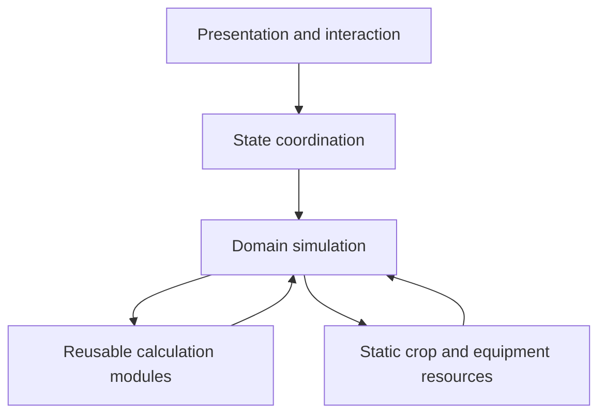

# Technical Architecture

## Entry points and presentation

`scenes/workshop.tscn` is the normal gameplay entry point. The workshop presentation and interaction layer is implemented by:

- `scripts/workshop_view.gd`
- `scripts/workstation_view.gd`
- `scripts/inventory_grid.gd`
- `scripts/workshop_slot.gd`
- `scripts/workshop_night_feedback.gd`
- `scripts/workshop_manual.gd`

`scenes/main.tscn` and `scenes/coffee_dashboard.tscn` remain legacy dashboard and compatibility entry points. They are not the normal workshop launch.

## State coordination

`scripts/coffee_farm.gd` coordinates crop selection, mutable plant state, seed instances, equipment, supplies, energy and nightly settlement. `scripts/game_state.gd` coordinates settlement timing and publishes outcomes consumed by the presentation layer.

The UI sends player actions and renders state or outcomes. Node names and workshop labels do not define simulation formulas.

## Domain simulation

The farming domain uses focused modules for liquids, crop data, genetics, reproduction and equipment:

- `scripts/liquid_composition.gd`
- `scripts/crop_genetics.gd`
- `scripts/seed_reproduction.gd`
- `scripts/equipment.gd`
- `scripts/dna_editor.gd`
- `scripts/pollution.gd`
- `scripts/coffee_farm.gd`

Simulation operations validate full resource requirements before committing state changes. UI actions are not allowed to create partial transactions.

## Static and mutable data

Static crop definitions are typed resources in `resources/`. Mutable plant and seed state remains separate so growth, health and inherited or edited traits can vary independently.

The liquid, growth, health, pollution, harvest and reproduction modules expose typed inputs and outputs. Unit-bearing fields identify values such as microlitres and kilojoules.

## Reusable calculations

The reusable calculation layer includes mineral concentration, mineral uptake, health changes, growth points, harvest quantities and equipment modifiers. Verified equations and rounding policies are documented in [FORMULAS.md](FORMULAS.md) and [CALCULATION_CONTRACT.md](CALCULATION_CONTRACT.md).

## Interaction architecture

Inventory controls use hover, selection and keyboard-focus states. Drag-and-drop eligibility is evaluated from live farm state at drag and drop time. Chamber, tool and manual dialogs restore focus appropriately and preserve inventory selection.

Tool feedback is presentation-only; it does not mutate farming state. Nightly settlement remains the source of resource and growth changes.

## Conceptual system structure

